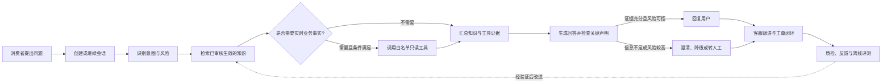
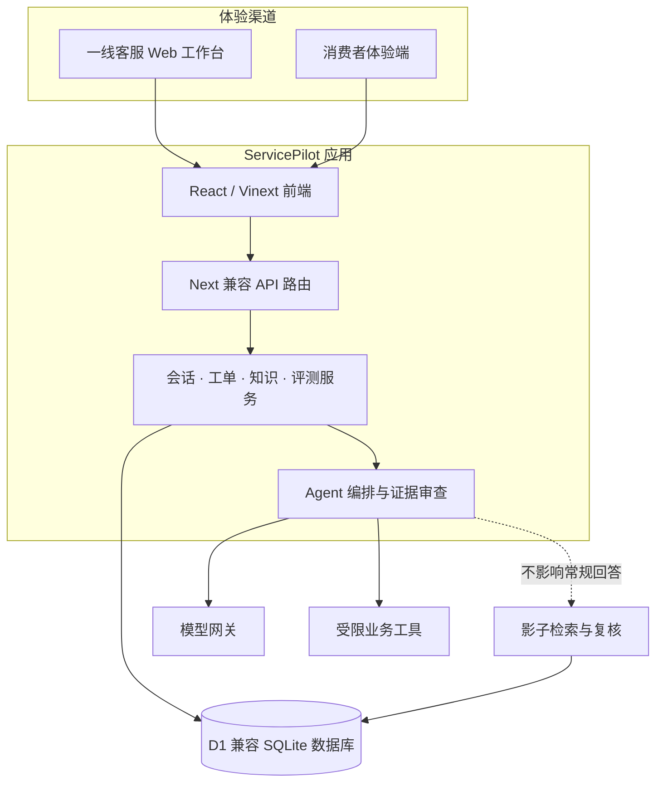

# ServicePilot

> 面向企业客服团队的 AI 客服与工单协同平台验证项目。ServicePilot 将消费者咨询、知识检索、风险判断、人工接管和工单处理串成一条可追溯的服务链路，重点探索：AI 什么时候可以回答、回答依据是什么，以及什么时候应该把问题交给人。

**项目状态：产品原型与技术验证中。** 仓库包含可运行的客服工作台、体验用户端、后端 API、D1 兼容数据模型和 AI Agent 实验链路；演示数据不代表真实企业业务数据。当前版本适合本地体验、流程验证和技术评估，不应直接用于处理真实客户或生产业务。

<p align="center">
  <a href="#项目背景">项目背景</a> ·
  <a href="#核心业务流程">核心流程</a> ·
  <a href="#功能与实现状态">功能状态</a> ·
  <a href="#快速开始">快速开始</a> ·
  <a href="#文档导航">文档导航</a>
</p>

## 项目背景

企业客服通常需要在会话、订单系统、内部知识和工单工具之间来回切换。规则散落、业务上下文缺失和处理过程不可追溯，会让客服重复询问用户、引用过期口径，或在高风险问题上给出未经核实的承诺。单纯接入一个大语言模型并不能解决这些问题：客服系统还需要知道问题属于什么业务、依据是否可信、是否具备执行条件，以及何时必须停止自动化并交由人工处理。

ServicePilot 因此以“**有依据地回答、可控地调用工具、必要时及时转人**”为设计原则，构建一个面向一线客服的验证型工作台。它把用户与客服的会话、工单和经过审核的知识放在同一个处理上下文中，并通过 Agent 编排、工具边界和审计记录验证完整的服务闭环。

## 设计目标

- **让客服围绕问题工作：** 从一个工作台进入会话、工单和知识查询，减少在多个系统之间切换的成本。
- **让 AI 回答有据可查：** 优先使用已审核生效的知识；涉及实时业务事实时，要求通过受限工具核实，而不是让模型猜测。
- **让风险处理有明确出口：** 对证据不足、规则冲突、工具失败或高风险情形进行澄清、安全降级或人工接管。
- **让服务过程可复盘：** 将会话、知识版本、Agent 运行、工具调用、工单和评测结果纳入持久化模型与审计设计。
- **以验证结果决定是否扩展：** 新检索和 Agent 能力先在隔离实验或影子链路中评估，不因“看起来更聪明”就直接替换稳定路径。

## 核心业务流程



### 一次 Agent 处理的主要阶段

1. **理解请求：** 根据当前问题及有限的会话上下文判断业务意图，例如退款、商品破损、物流改址或发票问题。
2. **评估风险：** 判断是否涉及高风险承诺、个人信息、证据缺失或需要人工决策的情形。
3. **检索知识：** 只将审核生效的知识作为可信业务口径；候选资料、未审核法规切片和生成式草稿不会自动成为回答依据。
4. **判断工具资格：** 只有在任务允许、参数经过校验且必要事实已验证时才调用受限工具。当前订单退款能力是只读查询，不执行退款或其他资金操作。
5. **生成并检查回答：** 将知识和工具结果整理成证据，再对实时状态、金额、时效和确定性承诺等关键声明进行约束；证据不够时优先追问或交由人工。
6. **交接并复盘：** 客服可查看会话和业务上下文、接管用户问题并创建或推进工单；评测和反馈用于发现问题，不自动证明线上效果提升。

## 功能与实现状态

当前前端启用的是**一线客服工作台**。下面按当前原型可体验的主路径，以及已存在但仍属验证/规划的能力分别说明，避免把产品设计或后台数据模型误认为已交付的生产功能。

| 模块 | 当前实现与用途 | 状态说明 |
| --- | --- | --- |
| 客服工作台 | 查看待处理概况与优先事项，作为一线客服工作入口 | 原型工作台；展示数据可能是演示数据 |
| 会话中心 | 浏览会话队列和消息上下文，查看知识/业务辅助信息，使用建议、补充信息、内部备注、转接或创建工单等处理入口 | 可交互原型并有对应 API；完整企业渠道接入与权限治理仍需建设 |
| 工单管理 | 围绕工单状态、优先级、负责人和 SLA 展示处理流程；提供工单 API、视图和导出相关能力 | 已有原型与后端实现；外部业务系统集成及生产策略需要按企业场景验证 |
| 知识库 | 管理知识内容及版本、审核状态、来源与反馈等知识治理信息 | 已有知识 API、数据模型和演示流程；规则需业务与合规负责人审核后才适合真实使用 |
| 消费者体验端 | 模拟不同用户身份发起咨询，用于观察用户提问、客服回复及会话处理链路 | 产品体验/演示入口，不等于已接入真实商城、会员或订单系统 |
| Agent 与模型网关 | 提供 Agent 回答接口、知识证据、风险处理、受限工具决策和模型调用降级 | 技术验证能力；不能据此推断已达到生产级准确率或服务 SLA |
| 评测与检索实验 | 包含冻结评测集、真实模型回归工具、向量索引和影子检索/复核数据 | 用于离线或影子验证；实验结果不等同于生产效果，影子结果不会改变常规回答 |
| 组织治理、策略、质检、分析与审计 | 仓库包含相应产品设计、数据模型、API 或验证代码 | 完整企业级运营能力尚未全部产品化；请以对应接口和页面的实际实现为准 |

### 当前知识与检索边界

知识库文件中包含 1,533 条资料：25 条结构化的 `active` 知识、1,008 条政府及监管来源切片，以及 500 条生成式候选；后两类默认处于待复核状态。Agent 的常规回答只使用审核生效的知识。知识数量不代表知识覆盖率、法规准确率或生产回答质量；在真实企业使用前，每条业务口径仍应经过业务和合规审核。

常规回答使用稳定的关键词知识检索路径。向量索引、重排与 Hybrid 方案属于隔离实验或影子观测：用于比较候选差异和收集复核证据，不自动进入常规回答，也不自动切换线上流量。详细边界和实验结论见[系统架构说明](docs/SYSTEM_ARCHITECTURE.md)与[知识库说明](docs/KNOWLEDGE_BASE.md)。

## 系统架构



### 技术栈

| 层次 | 技术 |
| --- | --- |
| Web 应用 | React 19、Vinext（Next.js 兼容应用框架）、Vite 8 |
| 服务端 API | Next 兼容路由、Node.js 类型与运行时工具 |
| 数据访问 | Drizzle ORM、Cloudflare D1 兼容 SQLite 数据库 |
| 本地/容器运行 | Wrangler、Docker Compose、Nginx |
| AI 接入 | OpenAI 兼容模型网关；模型与密钥通过运行时配置注入 |
| 测试与质量 | Node.js 内置测试运行器、ESLint、离线评测脚本 |

### 主要数据实体

数据库 schema 与迁移覆盖组织与成员、会话与消息、工单与视图、知识与版本、来源快照、反馈与审核、质检、策略版本、Agent 运行、评测结果、检索索引及审计记录等实体。当前演示空间以单租户种子数据为主；具备 `organizationId` 字段不等于服务端租户隔离和 RBAC 已完成生产级验证。

## 技术验证与评测

仓库包含固定场景种子集、真实模型回归评测代码、CSDS 数据集覆盖分析，以及检索候选的影子复核机制。评测涉及正常咨询、边界条件、高风险、对抗输入和隐私场景，目标是让行为差异可以复现和检查。

评测数字必须结合数据集、样本定义、评分口径、模型版本和运行时间解读。离线指标不能直接当作线上通过率、客服效率或用户满意度；不同评测集也不能在口径不一致时简单横向比较。项目的基线、数据卡和误差分析见[评测基线](docs/EVALUATION_BASELINE.md)、[数据集说明](docs/DATASET_CARD.md)及[知识覆盖差距分析](docs/CSDS_KB_COVERAGE_GAP_ANALYSIS.md)。

## 快速开始

### 环境要求

- Node.js `>=22.13.0`
- pnpm（仓库使用 `pnpm-lock.yaml`）
- 如需调用真实模型：一个兼容当前网关的 API Key；不配置密钥时只能验证相应的安全降级路径
- 如需容器运行：Docker 与 Docker Compose

### 本地运行

```bash
git clone https://github.com/iostreamwudi/servicepilot.git
cd servicepilot
pnpm install --frozen-lockfile
cp .env.example .env.local
pnpm dev
```

开发服务器启动后，按终端提示打开本地地址。`.env.local` 仅供本地使用，不要提交真实密钥。需要真实模型调用时，请按实际供应商配置模型网关地址、模型名和密钥；默认配置可在[`.env.example`](.env.example)中查看。`/api/bootstrap` 用于初始化演示数据，重复调用按项目逻辑幂等处理。

### 自托管容器运行

1. 在 `deploy/secrets/.dev.vars` 配置运行时模型密钥和其他敏感变量；该文件应保持在 Git 忽略范围内。
2. 在仓库根目录运行：

   ```bash
   docker compose -f deploy/docker-compose.yml up --build -d
   ```

3. 检查容器健康状态和服务日志，并在部署环境中验证应用及 API。

Compose 配置包含应用容器、Nginx 和独立持久化数据卷。当前配置面向项目验证/演示；默认没有完整企业身份认证、租户隔离与生产灾备方案。**请勿将公开演示部署直接用于真实客户数据。** 部署细节和运维要求见 [`deploy/`](deploy/) 目录。

### 常用命令

| 命令 | 用途 |
| --- | --- |
| `pnpm dev` | 启动本地开发服务 |
| `pnpm build` | 构建应用 |
| `pnpm start` | 启动构建后的应用 |
| `pnpm test` | 先构建，再运行 `tests/*.test.mjs` |
| `pnpm lint` | 运行 ESLint |
| `pnpm db:generate` | 根据 Drizzle schema 生成数据库迁移 |

## API 概览

API 使用仓库内的 App Router 路由实现。主要接口族如下；参数、权限上下文和响应结构应以对应路由代码为准，不能仅凭路径推断接口已具备生产级安全保证。

| 接口族 | 用途 |
| --- | --- |
| `/api/bootstrap` | 初始化演示数据 |
| `/api/agent/respond`、`/api/agent/runs` | Agent 回复与运行记录 |
| `/api/conversations` | 会话队列、会话详情和消息处理 |
| `/api/tickets`、`/api/ticket-views` | 工单及保存视图相关操作 |
| `/api/knowledge` | 知识查询、维护、审核辅助和反馈相关操作 |
| `/api/evaluations` | 离线评测与复核相关操作 |
| `/api/retrieval/shadows` | 检索影子运行与复核数据 |
| `/api/tools/order-refund` | 受限只读订单/退款查询工具 |
| `/api/workbench`、`/api/audit`、`/api/health/agent` | 工作台、审计和 Agent 健康检查 |

## 安全、隐私与已知限制

ServicePilot 当前是验证项目，不是可直接承载真实业务的多租户 SaaS。接入真实数据或对公网开放前，至少需要完成以下工作：

- **身份认证与服务端授权：** 在服务端验证成员身份、组织关系和角色；不能信任客户端传入的组织 ID 或角色。
- **租户隔离审计：** 对每个读写 API、后台任务、导出和工具调用做跨租户访问测试。
- **密钥管理：** 将模型与外部系统密钥放在受控的 Secret 管理服务中；轮换已暴露的凭证，禁止提交到 Git。
- **个人信息保护：** 仅处理必要数据，对日志、模型上下文、导出文件和评测数据执行脱敏、留存期限和访问控制。
- **业务工具沙箱：** 当前退款工具是只读验证路径，不具备真实退款执行能力；接入外部系统前应配置沙箱、授权、幂等、超时和审计。
- **生产运维：** 增加 TLS、网关认证、限流与滥用防护、集中式日志、告警、备份恢复、灾备和发布回滚演练。
- **业务与法规审核：** 审核种子知识的来源、适用范围、时效和企业内部口径；官方来源摘要本身不替代法务审核。

## 文档导航

- [产品蓝图](docs/PRODUCT_BLUEPRINT.md)：定位、角色、业务闭环、功能地图和异常处理设计。
- [系统架构与企业化边界](docs/SYSTEM_ARCHITECTURE.md)：分层架构、Agent 边界、租户/权限和待补齐能力。
- [知识库说明](docs/KNOWLEDGE_BASE.md)：知识来源、状态、检索路径、审核和更新要求。
- [交付路线图](docs/DELIVERY_ROADMAP.md)：验证阶段、交付策略和生产化计划。
- [评测基线](docs/EVALUATION_BASELINE.md)：冻结评测、评分方式、结果与结论边界。
- [数据集说明](docs/DATASET_CARD.md)：评测数据来源、用途及使用限制。
- [知识覆盖差距分析](docs/CSDS_KB_COVERAGE_GAP_ANALYSIS.md)：数据集场景与知识覆盖差距。
- [项目记忆](docs/PROJECT_MEMORY.md)：项目阶段信息与技术决策记录。
- [产品需求文档](docs/ServicePilot_PRD_v1.0.docx)：早期产品需求与范围说明；实现状态以代码为准。

## 路线与后续工作

项目后续工作的核心不是盲目增加模型或切换检索算法，而是先补足真实业务验证所需的证据：使用独立数据验证知识覆盖和 Agent 泛化能力；人工复核影子检索中的改善与退化案例；在隔离沙箱验证工具超时、无效参数和迟到结果；完成服务端 RBAC、租户隔离、监控告警和备份恢复。只有通过预先定义的质量与安全门槛后，才考虑小流量灰度或扩大自动化范围。

更完整的阶段安排见[交付路线图](docs/DELIVERY_ROADMAP.md)。文档中的目标、设计和未来事项不代表已经实现。

## 参与与问题反馈

这是一个持续演进的产品验证仓库。欢迎通过 GitHub Issues 描述可复现的问题、预期行为和运行环境；提交代码前请勿附带真实客户信息、API Key、访问令牌或生产日志。暂未提供正式的开源许可证，因此在仓库所有者明确添加许可证前，请不要假定代码可自由用于再分发或商业用途。

## 许可证

**当前仓库未声明开源许可证。** 未声明许可证不等于默认授予开源使用、修改或再分发权限。若要公开复用，请先联系仓库所有者并确认授权。
